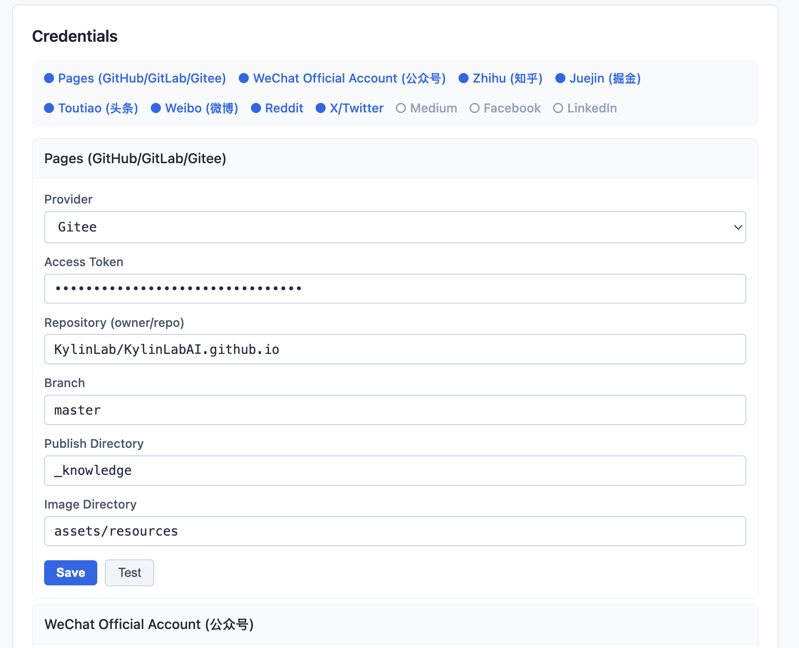
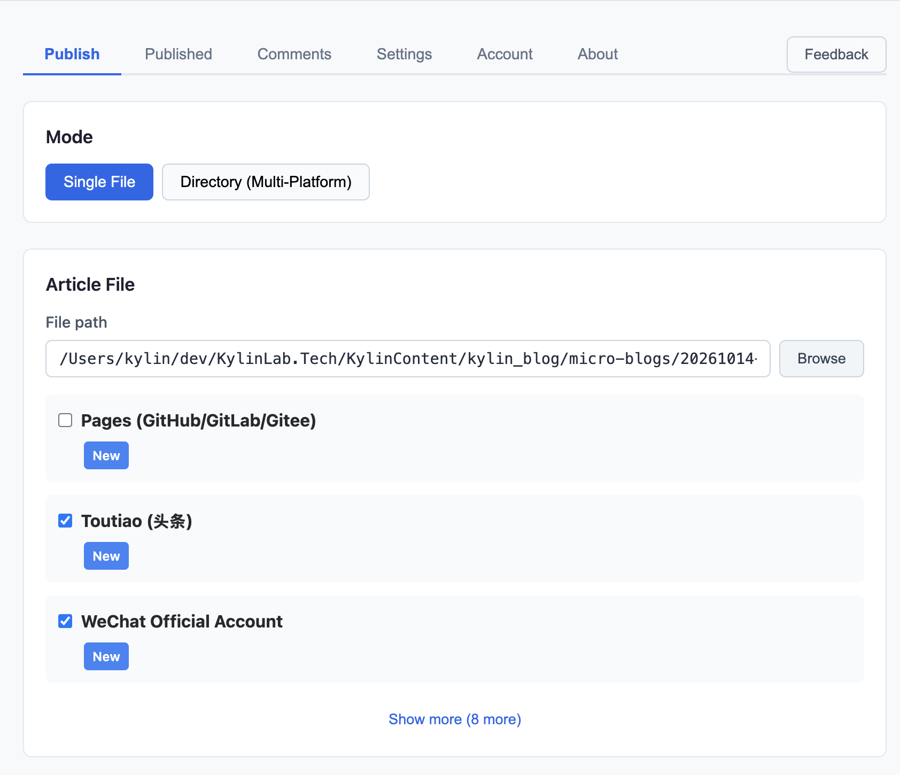
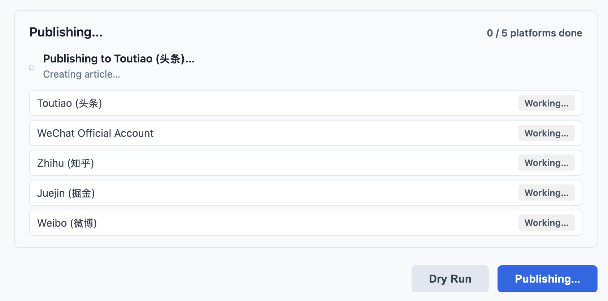
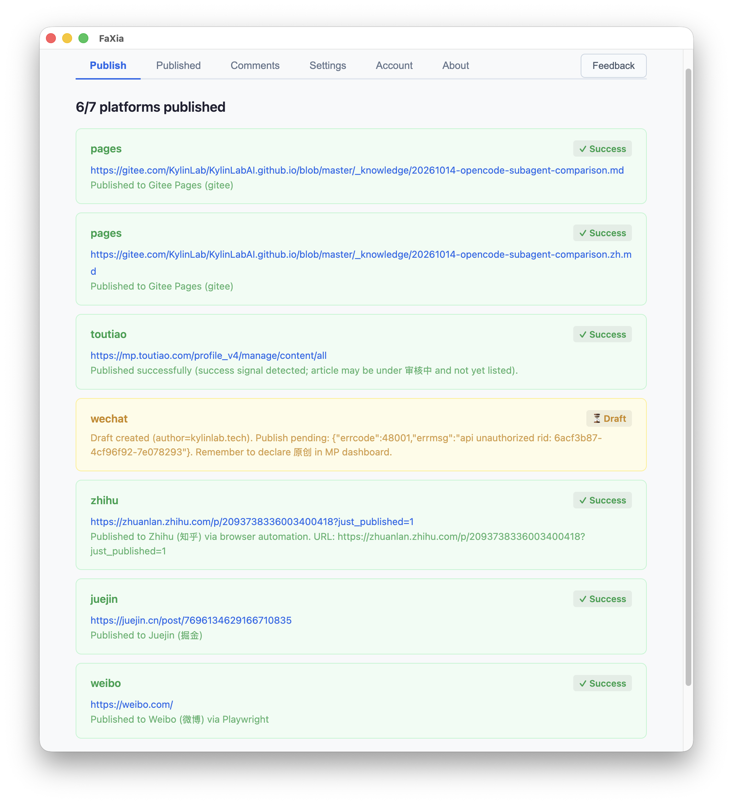
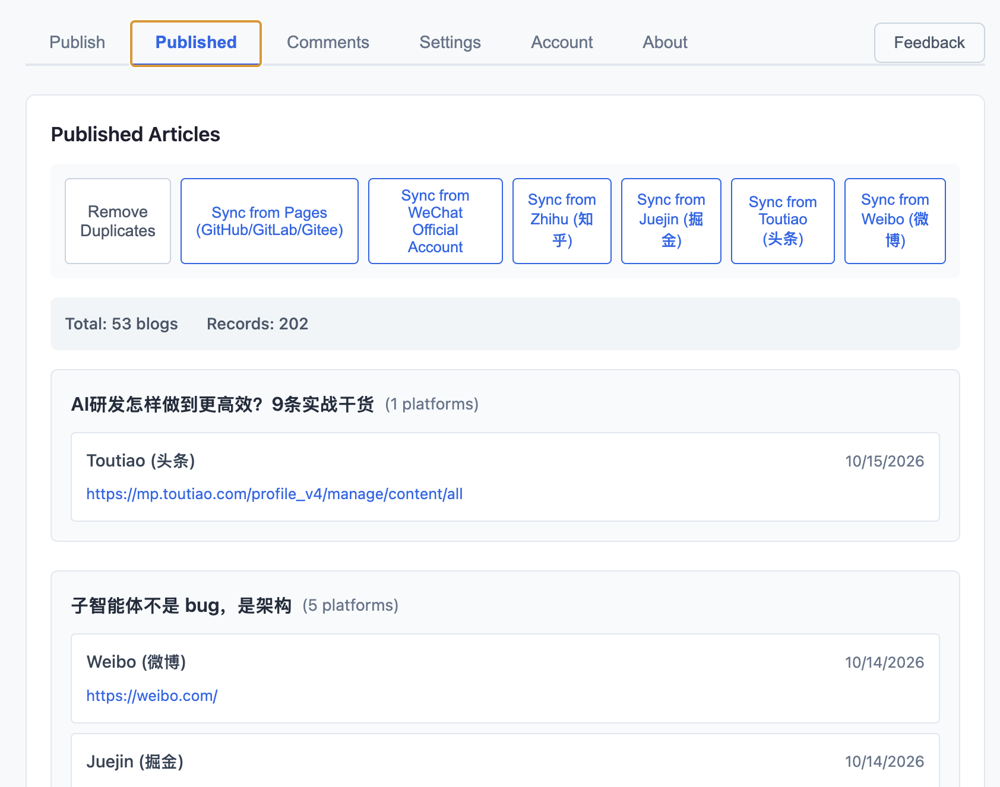
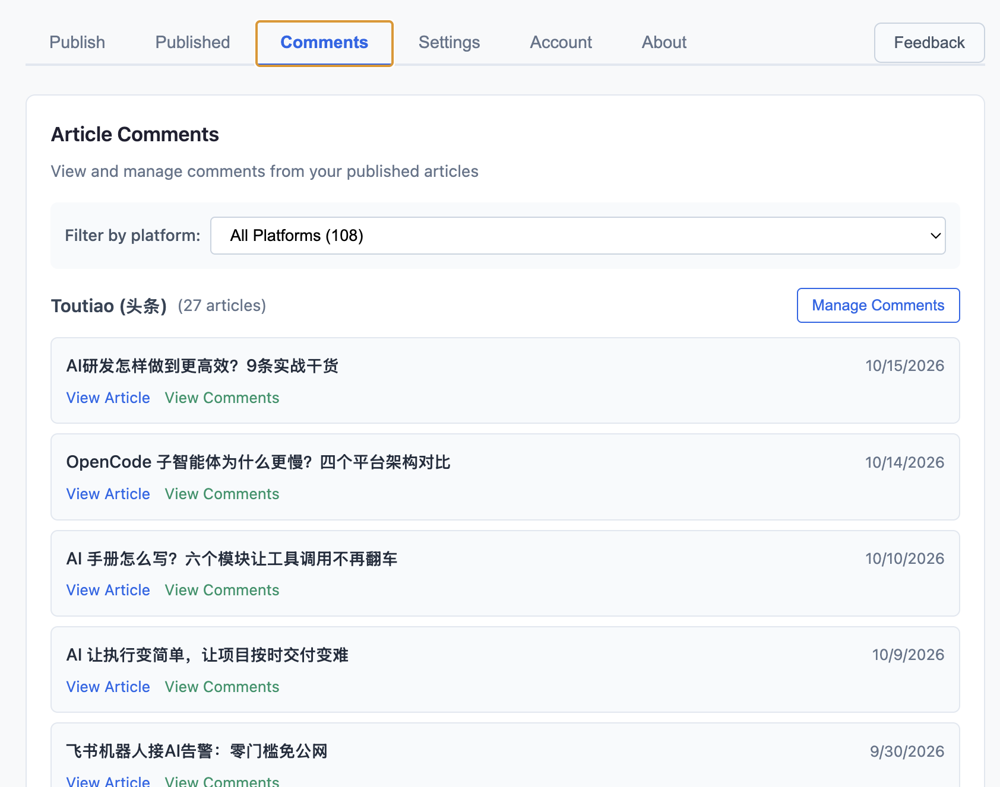
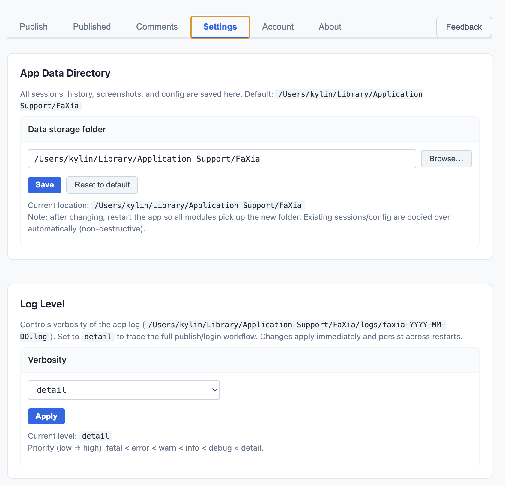
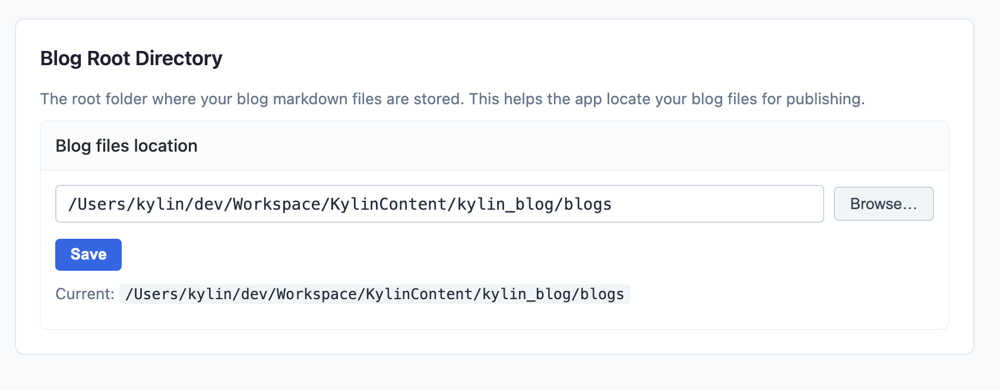
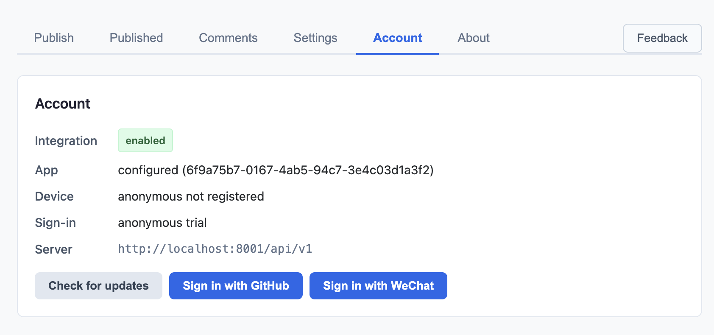

# FaXia — User Manual

[中文介绍](user_manual.zh.md)

## Introduction

Welcome to FaXia. This manual guides you through every feature, organized by what you want to accomplish.

## Content Creator Guide

### Getting Started

#### Task: Install FaXia

**Prerequisites:**
- Windows 10+ (x64), macOS 11+, or Ubuntu 20.04+ / Fedora 36+ (x64)
- Node.js 20+ (for CLI users)

**Steps:**

1. Download the installer from [GitHub Releases](https://github.com/KylinLabAI/FaXia-App/releases/latest)
   - You will see: Download page with available installers for your platform

2. Run the installer and follow the prompts
   - You will see: Installation wizard guiding you through setup

3. Launch FaXia from your applications folder or start menu
   - You will see: The main application window with nine tabs: Publish, Published, Comments, Compose, Blogs, Skills, Settings, Account, and About (plus a Feedback button)

**Expected result:** FaXia is installed and running successfully

**Troubleshooting:**

| Problem | Solution |
|---------|----------|
| Installation blocked by system security | Go to System Preferences/Settings and allow the app from "Unknown Sources" |
| CLI command not found | Reinstall the desktop app (the CLI ships with it), or from a source checkout use `npm run start` and ensure Node.js is in your PATH |

#### Task: Configure Platform Credentials

**Prerequisites:**
- FaXia is installed and running
- You have accounts on the platforms you want to publish to

**Steps:**

1. Click on the Settings tab
   - You will see: Settings page with sections for Credentials, AI Endpoint, App Data Directory, Log Level, and Blog Root Directory (draft root / blogs root / repo)

2. For each platform you want to configure:
   - Click on the platform name
   - Enter the required credentials (API tokens, app IDs, secrets, etc.)
   - Click Save

3. Click "Check Credentials" to verify all configured platforms are working
   - You will see: Status indicators showing success or failure for each platform

**Expected result:** All configured platforms show "Connected" status

**Troubleshooting:**

| Problem | Solution |
|---------|----------|
| Credentials rejected | Double-check the API tokens and ensure they have sufficient permissions |
| Zhihu authentication fails | Switch Zhihu to Playwright mode in Settings — the desktop app bundles its own Chromium, so no Playwright install is needed (only source/CLI builds need `npx playwright install chromium`) |

### Daily Operations

#### Task: Publish an Article

**Prerequisites:**
- Platform credentials are configured and validated
- You have a Markdown article ready to publish

**Steps:**

1. Click on the Publish tab
   - You will see: Publish interface with mode selection and file upload

2. Choose publish mode:
   - Single Platform: Select one platform from the dropdown
   - All Platforms: Publish to all configured platforms simultaneously

3. Click "Select File" and choose your Markdown file
   - You will see: File selected with preview option

4. (Optional) Enable "Dry Run" to preview without actual publishing
   - You will see: Preview of the publishing process

5. Click "Publish"
   - You will see: Progress indicators for each platform showing success or failure

**Expected result:** Article is published to selected platforms with direct links provided

**Troubleshooting:**

| Problem | Solution |
|---------|----------|
| Image upload fails | Check that images are referenced correctly in Markdown and that platform has image upload quota |
| One platform fails | Check platform-specific issues (API rate limits, content restrictions) |

#### Task: Update a Published Article

**Prerequisites:**
- Article was previously published using FaXia
- You have updated the Markdown file

**Steps:**

1. Click on the Published tab
   - You will see: List of all previously published articles

2. Find the article you want to update and click "Update"
   - You will see: Confirmation dialog with article details

3. Select the updated Markdown file
   - You will see: Preview of changes

4. Click "Update" to republish
   - You will see: Progress indicators for each platform

**Expected result:** Existing articles are updated on all platforms

**Troubleshooting:**

| Problem | Solution |
|---------|----------|
| Update not found | Ensure the article was originally published through FaXia |

#### Task: Monitor Comments

**Prerequisites:**
- Platform credentials are configured
- Articles have been published and received comments

**Steps:**

1. Click on the Comments tab
   - You will see: Centralized view of comments from all connected platforms

2. Filter comments by platform
   - You will see: Filtered list of comments

3. Each article shows its comment counts (total / unreplied) and a link that
   opens the platform's own comment page

**Expected result:** Comments are visible from one interface.

> Replying to comments from inside FaXia is **not supported yet** — use the
> link to reply on the platform itself. Status filters (new / replied /
> resolved) are also not implemented; only platform filtering is available.

**Troubleshooting:**

| Problem | Solution |
|---------|----------|
| Comments not loading | Check platform API credentials and rate limits |

### Settings

#### Task: Configure Data Directory

**Prerequisites:**
- FaXia is running

**Steps:**

1. Click on the Settings tab
2. Click on "App Data Directory" section
3. Click "Browse" to select a folder for storing sessions, history, screenshots, and config
4. Click "Save"

**Expected result:** Data directory is updated

#### Task: Configure Blog Settings

**Prerequisites:**
- FaXia is running

**Steps:**

1. Click on the Settings tab
2. Click on "Blog Root Directory" section
3. Set the root folder where your blog Markdown files are stored
4. Click "Save"

**Expected result:** Blog settings are updated

#### Task: Manage Account and Updates

**Prerequisites:**
- FaXia is running

**Steps:**

1. Click on the Account tab
   - You will see: Integration, app, device, and sign-in status

2. Click "Check for updates" to look for a newer release

3. Sign in with GitHub or WeChat to activate your license

**Expected result:** Account and update status are shown

## Appendix

### Keyboard Shortcuts

FaXia does not register application-level keyboard shortcuts — every action is
performed with the mouse in the desktop UI. The table below is reserved for a
future release and is **not implemented**.

| Shortcut | Action (planned) |
|----------|------------------|
| Ctrl/Cmd + P | Open Publish tab |
| Ctrl/Cmd + L | Open Published tab |
| Ctrl/Cmd + C | Open Comments tab |
| Ctrl/Cmd + S | Open Settings tab |
| Ctrl/Cmd + Enter | Publish article |

### Glossary

| Term | Definition |
|------|------------|
| CLI | Command Line Interface - text-based interface for advanced users |
| Dry Run | Preview mode that simulates publishing without actual posting |
| Frontmatter | YAML metadata at the top of Markdown files for title, tags, etc. |
| Playwright | Browser automation tool used for platforms without official APIs |